# User Management Service

## C3 — Summary

This C3 Component diagram illustrates the internal architecture of the User Management Service (SRV-001), which is responsible for handling user authentication, authorization, profile management, accessibility features, emergency access, and cross-device synchronization. The service is structured in a layered architecture with clear separation of concerns between presentation, business logic, data access, integration, and infrastructure components. The diagram shows how these components interact with each other and with external dependencies such as the User Database, Event Bus, Notification Service, Encryption Service, and API Gateway. Key features implemented include end-to-end encryption, accessibility features, emergency access, and cross-device synchronization as specified in the related features F-07, F-08, F-09, and F-12.

## C3 — Insights

- The service follows a layered architecture pattern with clear separation of concerns, making it easier to maintain and extend functionality
- Security is implemented at multiple levels: SecurityFilter for API security, EncryptionService for data protection, and AuditLogger for comprehensive audit trails
- The service implements the features F-07 (Accessibility), F-08 (Emergency Access), F-09 (Cross-device Synchronization), and F-12 (End-to-End Encryption) as required
- Event-driven architecture is used for synchronization across devices, with the SyncEventPublisher publishing events to the Event Bus
- The service follows the Single Responsibility Principle with specialized components for authentication, user profiles, accessibility, emergency access, and synchronization
- Transaction management is centralized through the TransactionManager component to ensure data consistency
- The service uses dependency injection to promote loose coupling between components
- Cross-cutting concerns like configuration, error handling, security, and metrics are handled by dedicated infrastructure components
- The service exposes multiple REST APIs through controllers that are secured by the SecurityFilter
- Health monitoring is implemented through the HealthCheckEndpoint to support system observability

## C3 — Interfaces

### Authentication API (REST API)
External REST API for user authentication and authorization operations

- POST /api/auth/login
- POST /api/auth/logout
- POST /api/auth/refresh
- POST /api/auth/reset-password
- GET /api/auth/verify

### User Profile API (REST API)
External REST API for managing user profile information

- GET /api/users/{id}
- POST /api/users
- PUT /api/users/{id}
- DELETE /api/users/{id}
- GET /api/users/me

### Accessibility API (REST API)
External REST API for managing user accessibility preferences

- GET /api/accessibility/preferences
- PUT /api/accessibility/preferences
- GET /api/accessibility/options
- POST /api/accessibility/voice-input

### Emergency Access API (REST API)
External REST API for emergency access to user health information

- POST /api/emergency/generate-code
- POST /api/emergency/validate-code
- GET /api/emergency/info/{code}
- PUT /api/emergency/settings
- GET /api/emergency/settings
- POST /api/emergency/revoke

### Synchronization API (REST API)
External REST API for cross-device data synchronization

- GET /api/sync/status
- POST /api/sync/pull
- POST /api/sync/push
- POST /api/sync/resolve-conflict
- GET /api/sync/devices

### Health Check API (REST API)
Internal API for service health monitoring

- GET /health
- GET /health/liveness
- GET /health/readiness
- GET /metrics

### User Repository Interface (Java Interface)
Internal interface for user authentication data access

- findUserById(id)
- findUserByUsername(username)
- findUserByEmail(email)
- saveUser(user)
- updateUserCredentials(id, credentials)
- deleteUser(id)

### Profile Repository Interface (Java Interface)
Internal interface for user profile data access

- findProfileById(id)
- saveProfile(profile)
- updateProfile(id, profile)
- deleteProfile(id)
- findProfilesByAttributes(attributes)

### Accessibility Repository Interface (Java Interface)
Internal interface for accessibility preferences data access

- findPreferencesByUserId(userId)
- savePreferences(userId, preferences)
- updatePreferences(userId, preferences)
- deletePreferences(userId)

### Emergency Access Repository Interface (Java Interface)
Internal interface for emergency access data

- findEmergencySettingsByUserId(userId)
- saveEmergencySettings(userId, settings)
- findAccessCodeByCode(code)
- saveAccessCode(accessCode)
- invalidateAccessCode(code)
- logAccessAttempt(accessAttempt)

### Sync Repository Interface (Java Interface)
Internal interface for synchronization data access

- findSyncStateByUserId(userId)
- saveSyncState(userId, syncState)
- findDevicesByUserId(userId)
- saveDevice(userId, device)
- removeDevice(userId, deviceId)
- findPendingChanges(userId, deviceId)

### Notification Client Interface (Java Interface)
Internal interface for sending notifications to users

- sendAuthNotification(userId, notificationType, data)
- sendProfileUpdateNotification(userId, data)
- sendEmergencyAccessNotification(userId, accessInfo)
- sendSyncNotification(userId, syncInfo)

### Sync Event Publisher Interface (Event Publisher)
Internal interface for publishing synchronization events

- publishProfileUpdateEvent(userId, profileData)
- publishPreferencesUpdateEvent(userId, preferencesData)
- publishDeviceRegistrationEvent(userId, deviceData)
- publishDeviceRemovalEvent(userId, deviceId)

### Encryption Client Interface (Java Interface)
Internal interface for encryption and decryption operations

- encryptData(userId, data)
- decryptData(userId, encryptedData)
- generateAccessCode(userId)
- verifyAccessCode(code)
- rotateUserKeys(userId)

### Audit Logger Interface (Java Interface)
Internal interface for security audit logging

- logAuthEvent(userId, eventType, details)
- logProfileEvent(userId, eventType, details)
- logEmergencyAccessEvent(userId, accessCode, accessorInfo)
- logSyncEvent(userId, deviceId, eventType)


## C3 — Relationships

- ? -> ?
- ? -> ?
- ? -> ?
- ? -> ?
- ? -> ?
- ? -> ?
- ? -> ?
- ? -> ?
- ? -> ?
- ? -> ?
- ? -> ?
- ? -> ?
- ? -> ?
- ? -> ?
- ? -> ?
- ? -> ?
- ? -> ?
- ? -> ?
- ? -> ?
- ? -> ?
- ? -> ?
- ? -> ?
- ? -> ?
- ? -> ?
- ? -> ?
- ? -> ?
- ? -> ?
- ? -> ?
- ? -> ?
- ? -> ?
- ? -> ?

## C3 — External dependencies

- Unnamed dependency
- Unnamed dependency
- Unnamed dependency
- Unnamed dependency
- Unnamed dependency

## C3 — Diagram

```mermaid
graph TB
    %% Styling
    classDef presentation fill:#B5E8F7,stroke:#000,stroke-width:1px
    classDef business fill:#D5E8D4,stroke:#000,stroke-width:1px
    classDef data fill:#FFE6CC,stroke:#000,stroke-width:1px
    classDef integration fill:#DAE8FC,stroke:#000,stroke-width:1px
    classDef infrastructure fill:#F8CECC,stroke:#000,stroke-width:1px
    classDef external fill:#E1D5E7,stroke:#000,stroke-width:1px

    %% Subgraphs for layers
    subgraph UserManagementService["User Management Service"]
        subgraph PresentationLayer["Presentation Layer"]
            AC[AuthController]
            UPC[UserProfileController]
            AbC[AccessibilityController]
            EAC[EmergencyAccessController]
            SC[SyncController]
            IV[InputValidator]
        end

        subgraph BusinessLayer["Business Layer"]
            AS[AuthService]
            UPS[UserProfileService]
            AbS[AccessibilityService]
            EAS[EmergencyAccessService]
            SS[SyncService]
            ES[EncryptionService]
        end

        subgraph DataLayer["Data Access Layer"]
            UR[UserRepository]
            PR[ProfileRepository]
            AR[AccessibilityRepository]
            EAR[EmergencyAccessRepository]
            SR[SyncRepository]
            TM[TransactionManager]
        end

        subgraph IntegrationLayer["Integration Layer"]
            NC[NotificationClient]
            SEP[SyncEventPublisher]
            EC[EncryptionClient]
            AL[AuditLogger]
        end

        subgraph InfrastructureLayer["Infrastructure"]
            CM[ConfigurationManager]
            HCE[HealthCheckEndpoint]
            SF[SecurityFilter]
            EH[ErrorHandler]
            MC[MetricsCollector]
        end
    end

    %% External Dependencies
    UDB[(User Database)]
    EB[Event Bus]
    NS[Notification Service]
    EnS[Encryption Service]
    APIG[API Gateway]

    %% Presentation Layer Relationships
    AC --> AS
    UPC --> UPS
    AbC --> AbS
    EAC --> EAS
    SC --> SS
    AC --> IV
    UPC --> IV
    AbC --> IV
    EAC --> IV
    SC --> IV

    %% Business Layer Relationships
    AS --> UR
    UPS --> PR
    AbS --> AR
    EAS --> EAR
    SS --> SR
    AS --> ES
    UPS --> ES
    EAS --> ES
    SS --> ES
    AS --> NC
    UPS --> NC
    EAS --> NC
    SS --> SEP
    AS --> AL
    EAS --> AL
    SS --> AL

    %% Data Access Layer Relationships
    UR --> UDB
    PR --> UDB
    AR --> UDB
    EAR --> UDB
    SR --> UDB
    UR --> TM
    PR --> TM
    AR --> TM
    EAR --> TM
    SR --> TM

    %% Integration Layer Relationships
    NC --> NS
    SEP --> EB
    EC --> EnS
    AL --> UDB

    %% Infrastructure Relationships
    SF --> AC
    SF --> UPC
    SF --> AbC
    SF --> EAC
    SF --> SC
    CM --> AS
    CM --> UPS
    CM --> AbS
    CM --> EAS
    CM --> SS
    EH --> AC
    EH --> UPC
    EH --> AbC
    EH --> EAC
    EH --> SC
    MC --> AC
    MC --> UPC
    MC --> AbC
    MC --> EAC
    MC --> SC

    %% External Relationships
    APIG --> AC
    APIG --> UPC
    APIG --> AbC
    APIG --> EAC
    APIG --> SC
    HCE --> APIG

    %% Apply styles
    class AC,UPC,AbC,EAC,SC,IV presentation
    class AS,UPS,AbS,EAS,SS,ES business
    class UR,PR,AR,EAR,SR,TM data
    class NC,SEP,EC,AL integration
    class CM,HCE,SF,EH,MC infrastructure
    class UDB,EB,NS,EnS,APIG external
```



## C4 — Classes

- User
- Email
- AccessibilityPreferences
- EmergencyAccess
- UserRepository
- EmergencyAccessRepository
- UserApplicationService
- EmergencyAccessApplicationService
- SynchronizationApplicationService
- UserRepositoryImpl
- EncryptionServiceImpl
- KafkaEventPublisher
- UserController
- EmergencyAccessController
- SecurityConfig

## C4 — Summary

This C4 Code diagram represents the User Management Service (SRV-001), which is responsible for handling user accounts, accessibility preferences, emergency access, and cross-device synchronization. The service follows a layered architecture with clear separation of concerns between domain, application, infrastructure, and presentation layers.

The domain layer contains core entities like User and EmergencyAccess, along with value objects such as Email and AccessibilityPreferences. It defines repository interfaces and domain services that encapsulate business rules.

The application layer provides services that orchestrate domain operations, including UserApplicationService, EmergencyAccessApplicationService, and SynchronizationApplicationService. These services handle commands and queries, transform domain objects to DTOs, and coordinate with infrastructure services.

The infrastructure layer implements repository interfaces, encryption services, event publishing, and audit logging. It contains concrete implementations like UserRepositoryImpl, EncryptionServiceImpl, and KafkaEventPublisher that interact with external systems and databases.

The presentation layer exposes REST APIs through controllers like UserController and EmergencyAccessController, handling HTTP requests and responses. It includes request/response models and global exception handling.

Cross-cutting concerns are addressed through configuration classes and aspects for security, encryption, and audit logging.

The diagram illustrates how these components interact to provide user management capabilities, with a focus on accessibility features (F-07), emergency access (F-08), cross-device synchronization (F-09), and end-to-end encryption (F-12).

## C4 — Insights

- 1. The service implements a clean architecture with clear separation between domain, application, infrastructure, and presentation layers, promoting maintainability and testability.
- 2. Domain-Driven Design principles are applied with rich domain models (User, EmergencyAccess) that encapsulate business rules and value objects (Email, AccessibilityPreferences) that validate their own consistency.
- 3. The service addresses all four related features (F-07, F-08, F-09, F-12) through dedicated components: AccessibilityPreferences for accessibility features, EmergencyAccess for emergency access, SynchronizationApplicationService for cross-device synchronization, and EncryptionServiceImpl for end-to-end encryption.
- 4. Repository interfaces in the domain layer enable dependency inversion, allowing the domain to remain independent of specific data access technologies.
- 5. The application layer acts as a facade, orchestrating domain operations and translating between domain objects and DTOs, which shields the domain from external concerns.
- 6. End-to-end encryption is implemented using envelope encryption with AWS KMS, following the P-11 Envelope Encryption pattern identified in the architectural patterns.
- 7. The event-driven architecture (P-03) is supported through the KafkaEventPublisher, enabling loose coupling between services and supporting cross-device synchronization.
- 8. The service follows RESTful API design principles with clear separation between request and response models in the presentation layer.
- 9. Cross-cutting concerns like security, encryption, and audit logging are handled through dedicated configuration classes and aspects, promoting separation of concerns.
- 10. The design supports internationalization with multiple languages (English, German, French, Italian) as required by the accessibility features (F-07).
- 11. The code structure demonstrates the use of dependency injection throughout the layers, making the system more testable and modular.
- 12. The emergency access feature implements time-limited access codes with proper validation and audit logging, addressing the security requirements of F-08.

## C4 — Methods

- **?.UserApplicationService.registerUser** — Registers a new user in the system. Validates input data, creates a User entity with encrypted password, generates encryption keys, and publishes a UserCreatedEvent. Returns a UserDTO with the created user's information.
- **?.UserApplicationService.updateAccessibilityPreferences** — Updates a user's accessibility preferences. Finds the user by ID, updates their preferences, saves the changes, and publishes a UserUpdatedEvent.
- **?.EmergencyAccessApplicationService.createEmergencyAccess** — Creates a new emergency access code for a user. Generates a secure access code, creates an EmergencyAccess entity with expiration time, saves it, and logs an audit event.
- **?.EmergencyAccessApplicationService.grantEmergencyAccess** — Validates an emergency access code and grants temporary access to the user's medical information. Logs the access attempt and returns limited user data if valid.
- **?.SynchronizationApplicationService.syncUserData** — Synchronizes user data across devices. Retrieves the last sync state, detects conflicts, applies changes, and returns a sync result with updated data.
- **?.EncryptionServiceImpl.encrypt** — Encrypts data using envelope encryption with AWS KMS. Uses the specified key ID to encrypt the data and returns the encrypted result.
- **?.EncryptionServiceImpl.rotateKey** — Rotates an encryption key by generating a new key, re-encrypting data with the new key, and returning the new key ID.
- **?.UserController.registerUser** — REST endpoint for user registration. Validates the request, calls the application service to register the user, and returns a response with the created user's information.
- **?.EmergencyAccessController.createEmergencyAccess** — REST endpoint for creating emergency access. Validates the user ID, calls the application service to create emergency access, and returns the access code and expiration time.
- **?.AuditAspect.logMethodExecution** — Aspect method that intercepts annotated methods, logs their execution with parameters and results, and records audit events for security-sensitive operations.

## C4 — Data structures

- UserDTO: Data Transfer Object representing a user, containing user ID, username, email, accessibility preferences, and emergency access status. Used for transferring user data between application and presentation layers.
- AccessibilityPreferencesDTO: Data Transfer Object containing user accessibility settings including high contrast mode, font size, voice input preference, and language selection.
- EmergencyAccessDTO: Data Transfer Object containing emergency access information including access ID, access code, and expiration time.
- RegisterUserCommand: Command object containing data required to register a new user, including username, email, password, and accessibility preferences.
- UpdateUserCommand: Command object containing data required to update an existing user, including user ID, username, email, and accessibility preferences.
- RegisterUserRequest: HTTP request model for user registration containing username, email, password, and accessibility preferences.
- UserResponse: HTTP response model containing user information to be returned to clients, including user ID, username, email, accessibility preferences, and emergency access status.
- SyncResultDTO: Data Transfer Object containing the result of a synchronization operation, including updated data, conflicts detected, and synchronization timestamp.
- ConflictResolutionDTO: Data Transfer Object containing information about how to resolve synchronization conflicts, including conflict IDs and resolution strategies.
- AuditEvent: Data structure representing a security-relevant event to be logged, including timestamp, user ID, action type, resource affected, and result.

## C4 — Code relationships

- Composition relationship where User contains an AccessibilityPreferences value object that encapsulates all accessibility settings. The User entity provides methods to update these preferences while maintaining encapsulation.
- Dependency relationship where UserApplicationService depends on the UserRepository interface for data access. This follows the Dependency Inversion Principle, allowing the application layer to remain independent of specific data access implementations.
- Implementation relationship where UserRepositoryImpl implements the UserRepository interface. This allows for different repository implementations (e.g., JDBC, JPA, MongoDB) without changing the application layer.
- Dependency relationship where UserController uses UserApplicationService to handle business logic. The controller translates HTTP requests to application service calls and transforms application responses to HTTP responses.
- Dependency relationship where EmergencyAccessApplicationService uses AuditService to log security-sensitive operations. This ensures all emergency access attempts are properly recorded for compliance and security monitoring.
- Dependency relationship where UserApplicationService uses EncryptionService for encrypting sensitive user data. This implements the end-to-end encryption requirement (F-12) using envelope encryption.
- Dependency relationship where UserApplicationService uses EventPublisher to publish domain events when user state changes. This supports the event-driven architecture pattern (P-03) and enables cross-device synchronization.
- Dependency relationship where AuditAspect uses AuditService to log method executions. This cross-cutting concern is implemented using aspect-oriented programming to separate audit logging from business logic.
- Dependency relationship where SynchronizationApplicationService uses SynchronizationRepository to store and retrieve synchronization state. This supports the cross-device synchronization feature (F-09).
- Dependency relationship where EncryptionServiceImpl uses AWS KMS Client for key management operations. This implements the envelope encryption pattern (P-11) for end-to-end encryption.

## C4 — Diagram

```mermaid
classDiagram
    %% Domain Layer
    class User {
        -userId: UUID
        -username: String
        -email: Email
        -passwordHash: String
        -accessibilityPreferences: AccessibilityPreferences
        -emergencyAccessEnabled: boolean
        -encryptionKeyId: String
        -status: UserStatus
        +enableEmergencyAccess() void
        +disableEmergencyAccess() void
        +updateAccessibilityPreferences(preferences) void
    }
    
    class Email {
        <<ValueObject>>
        -address: String
        +validate() boolean
    }
    
    class AccessibilityPreferences {
        <<ValueObject>>
        -highContrast: boolean
        -fontSize: FontSize
        -voiceInputEnabled: boolean
        -preferredLanguage: Language
    }
    
    class UserStatus {
        <<Enumeration>>
        ACTIVE
        INACTIVE
        LOCKED
        PENDING_VERIFICATION
    }
    
    class FontSize {
        <<Enumeration>>
        SMALL
        MEDIUM
        LARGE
        EXTRA_LARGE
    }
    
    class Language {
        <<Enumeration>>
        ENGLISH
        GERMAN
        FRENCH
        ITALIAN
    }
    
    class EmergencyAccess {
        -accessId: UUID
        -userId: UUID
        -accessCode: String
        -expirationTime: DateTime
        -isUsed: boolean
        +isValid() boolean
        +markAsUsed() void
    }
    
    class UserRepository {
        <<Interface>>
        +findById(userId) User
        +findByEmail(email) User
        +save(user) User
        +delete(userId) void
    }
    
    class EmergencyAccessRepository {
        <<Interface>>
        +findByUserId(userId) EmergencyAccess
        +findByAccessCode(code) EmergencyAccess
        +save(emergencyAccess) EmergencyAccess
        +deleteExpired() void
    }
    
    class UserDomainService {
        +validateUserCredentials(username, password) boolean
        +generatePasswordHash(password) String
        +validatePasswordStrength(password) boolean
    }
    
    class EmergencyAccessDomainService {
        +generateAccessCode() String
        +validateAccessCode(code) boolean
    }
    
    %% Application Layer
    class UserApplicationService {
        -userRepository: UserRepository
        -encryptionService: EncryptionService
        -eventPublisher: EventPublisher
        +registerUser(command) UserDTO
        +updateUser(command) UserDTO
        +deleteUser(userId) void
        +getUserById(userId) UserDTO
        +updateAccessibilityPreferences(userId, preferences) void
    }
    
    class EmergencyAccessApplicationService {
        -emergencyAccessRepository: EmergencyAccessRepository
        -userRepository: UserRepository
        -encryptionService: EncryptionService
        -auditService: AuditService
        +createEmergencyAccess(userId) EmergencyAccessDTO
        +validateEmergencyAccess(accessCode) boolean
        +grantEmergencyAccess(accessCode) EmergencyAccessGrantDTO
        +revokeEmergencyAccess(accessId) void
    }
    
    class SynchronizationApplicationService {
        -userRepository: UserRepository
        -syncRepository: SynchronizationRepository
        -encryptionService: EncryptionService
        +syncUserData(userId, deviceId) SyncResultDTO
        +resolveConflicts(userId, conflictResolution) void
    }
    
    class UserDTO {
        +userId: UUID
        +username: String
        +email: String
        +accessibilityPreferences: AccessibilityPreferencesDTO
        +emergencyAccessEnabled: boolean
    }
    
    class UserEventHandler {
        -eventPublisher: EventPublisher
        +handleUserCreated(event) void
        +handleUserUpdated(event) void
        +handleUserDeleted(event) void
    }
    
    %% Infrastructure Layer
    class UserRepositoryImpl {
        -jdbcTemplate: JdbcTemplate
        -userMapper: UserMapper
        +findById(userId) User
        +findByEmail(email) User
        +save(user) User
        +delete(userId) void
    }
    
    class EmergencyAccessRepositoryImpl {
        -jdbcTemplate: JdbcTemplate
        -emergencyAccessMapper: EmergencyAccessMapper
        +findByUserId(userId) EmergencyAccess
        +findByAccessCode(code) EmergencyAccess
        +save(emergencyAccess) EmergencyAccess
        +deleteExpired() void
    }
    
    class EncryptionServiceImpl {
        -kmsClient: KMSClient
        -keyCache: Cache~String, String~
        +encrypt(data, keyId) String
        +decrypt(encryptedData, keyId) String
        +generateUserKey() String
        +rotateKey(oldKeyId) String
    }
    
    class KafkaEventPublisher {
        -kafkaTemplate: KafkaTemplate
        -objectMapper: ObjectMapper
        +publishEvent(event) void
    }
    
    class AuditServiceImpl {
        -elasticsearchClient: ElasticsearchClient
        -objectMapper: ObjectMapper
        +logAuditEvent(event) void
        +queryAuditEvents(userId, startDate, endDate) List~AuditEvent~
    }
    
    %% Presentation Layer
    class UserController {
        -userApplicationService: UserApplicationService
        +registerUser(request) ResponseEntity~UserResponse~
        +getUser(userId) ResponseEntity~UserResponse~
        +updateUser(userId, request) ResponseEntity~UserResponse~
        +deleteUser(userId) ResponseEntity~Void~
        +updateAccessibilityPreferences(userId, request) ResponseEntity~Void~
    }
    
    class EmergencyAccessController {
        -emergencyAccessApplicationService: EmergencyAccessApplicationService
        +createEmergencyAccess(userId) ResponseEntity~EmergencyAccessResponse~
        +validateEmergencyAccess(request) ResponseEntity~Boolean~
        +grantEmergencyAccess(request) ResponseEntity~EmergencyAccessGrantResponse~
        +revokeEmergencyAccess(accessId) ResponseEntity~Void~
    }
    
    class GlobalExceptionHandler {
        +handleValidationException(ex) ResponseEntity~ErrorResponse~
        +handleResourceNotFoundException(ex) ResponseEntity~ErrorResponse~
        +handleAuthorizationException(ex) ResponseEntity~ErrorResponse~
    }
    
    %% Cross-Cutting Concerns
    class SecurityConfig {
        +passwordEncoder() PasswordEncoder
        +authenticationManager() AuthenticationManager
        +securityFilterChain(http) SecurityFilterChain
    }
    
    class EncryptionConfig {
        +kmsClient() KMSClient
        +keyCache() Cache~String, String~
    }
    
    class AuditAspect {
        -auditService: AuditService
        +logMethodExecution(joinPoint) Object
    }
    
    %% Relationships
    User --> Email : contains
    User --> AccessibilityPreferences : contains
    User --> UserStatus : has
    AccessibilityPreferences --> FontSize : has
    AccessibilityPreferences --> Language : has
    EmergencyAccess --> User : belongs to
    
    UserApplicationService --> UserRepository : uses
    UserApplicationService --> "EncryptionService" : uses
    UserApplicationService --> "EventPublisher" : uses
    
    EmergencyAccessApplicationService --> EmergencyAccessRepository : uses
    EmergencyAccessApplicationService --> UserRepository : uses
    EmergencyAccessApplicationService --> "EncryptionService" : uses
    EmergencyAccessApplicationService --> "AuditService" : uses
    
    SynchronizationApplicationService --> UserRepository : uses
    SynchronizationApplicationService --> "SynchronizationRepository" : uses
    SynchronizationApplicationService --> "EncryptionService" : uses
    
    UserRepositoryImpl ..|> UserRepository : implements
    EmergencyAccessRepositoryImpl ..|> EmergencyAccessRepository : implements
    EncryptionServiceImpl ..|> "EncryptionService" : implements
    KafkaEventPublisher ..|> "EventPublisher" : implements
    AuditServiceImpl ..|> "AuditService" : implements
    
    UserController --> UserApplicationService : uses
    EmergencyAccessController --> EmergencyAccessApplicationService : uses
    
    AuditAspect --> "AuditService" : uses
```

## API specification — Endpoints

### GET /api/v1/users
Retrieves a paginated list of users with optional filtering

### GET /api/v1/users/{id}
Retrieves a specific user by their unique identifier

### POST /api/v1/users
Creates a new user account

### PUT /api/v1/users/{id}
Updates an existing user's information

### DELETE /api/v1/users/{id}
Deletes a user account

### GET /api/v1/users/me
Retrieves the profile of the currently authenticated user

### PUT /api/v1/users/me
Updates the profile of the currently authenticated user

### POST /api/v1/users/password
Changes the password for the currently authenticated user

### POST /api/v1/users/password/reset
Initiates a password reset process for a user

### POST /api/v1/users/password/reset/{token}
Completes the password reset process using a token

### GET /api/v1/users/preferences
Retrieves the preferences for the currently authenticated user

### PUT /api/v1/users/preferences
Updates the preferences for the currently authenticated user

### GET /api/v1/users/{id}/accessibility
Retrieves the accessibility settings for a specific user

### PUT /api/v1/users/{id}/accessibility
Updates the accessibility settings for a specific user

### GET /api/v1/users/{id}/emergency-access
Retrieves the emergency access settings for a specific user

### PUT /api/v1/users/{id}/emergency-access
Updates the emergency access settings for a specific user

### POST /api/v1/users/{id}/emergency-access/code
Generates a new emergency access code for a specific user

### POST /api/v1/emergency-access/{code}
Provides emergency access to user information using a valid emergency code

### GET /api/v1/users/{id}/devices
Retrieves a list of devices associated with a specific user

### DELETE /api/v1/users/{id}/devices/{deviceId}
Removes a device from a user's account

### GET /api/v1/users/{id}/sync-settings
Retrieves the cross-device synchronization settings for a specific user

### PUT /api/v1/users/{id}/sync-settings
Updates the cross-device synchronization settings for a specific user

### POST /api/v1/auth/login
Authenticates a user and returns an access token

### POST /api/v1/auth/refresh
Refreshes an access token using a refresh token

### POST /api/v1/auth/logout
Invalidates the current user session

### POST /api/v1/auth/register
Registers a new user account

### GET /api/v1/auth/verify/{token}
Verifies a user's email address using a verification token

### GET /api/v1/health
Checks the health status of the User Management Service

### POST /api/v1/users/export
Exports a user's data in an encrypted format

### GET /api/v1/users/export/{exportId}
Checks the status of a data export operation

## API specification — Summary

The User Management Service API provides comprehensive functionality for managing user accounts, authentication, and related features in a medication management system. It supports user registration, authentication, profile management, accessibility settings, emergency access, and cross-device synchronization.

The API follows RESTful design principles with resource-oriented endpoints and standard HTTP methods. It implements JWT-based authentication with OAuth 2.0 authorization framework and role-based access control. The API supports multi-language accessibility features, emergency access for medical personnel, and secure cross-device synchronization.

Key features include:
1. User account management (registration, profile updates, password management)
2. Authentication and authorization with JWT tokens
3. User preferences and accessibility settings
4. Emergency access functionality for medical emergencies
5. Cross-device synchronization settings
6. Encrypted data export capabilities

The API is designed with security in mind, implementing end-to-end encryption, rate limiting, and comprehensive error handling. It follows best practices for API design including consistent naming conventions, proper HTTP status codes, and detailed documentation.

## API specification — Insights

- The API design incorporates accessibility features (F-07) through dedicated endpoints for managing user accessibility settings, supporting requirements like visual accessibility options and voice input support.
- Emergency access functionality (F-08) is implemented with endpoints for configuring emergency access settings, generating time-limited access codes, and providing emergency personnel with secure access to critical medical information.
- Cross-device synchronization (F-09) is supported through device management endpoints and synchronization settings that allow users to control how their data is synchronized across multiple devices.
- End-to-end encryption (F-12) is integrated throughout the API, particularly in the data export functionality which provides encrypted exports of user data.
- The API follows RESTful design principles with resource-oriented endpoints, consistent naming conventions, and appropriate HTTP methods for different operations.
- Authentication is implemented using JWT tokens with OAuth 2.0 authorization framework, supporting both access tokens and refresh tokens for improved security.
- Role-based access control is implemented to ensure users can only access appropriate resources, with different endpoints requiring different role permissions.
- The API includes comprehensive error handling with consistent error response formats and appropriate HTTP status codes for different error conditions.
- Pagination is implemented for collection endpoints to handle large datasets efficiently and improve performance.
- The API supports internationalization through user preferences that include language settings, supporting the multi-language accessibility requirement.
- Health check endpoints are provided to monitor the service status, supporting operational requirements for system monitoring.
- The API design considers security best practices including rate limiting, secure password handling, and proper authentication/authorization mechanisms.

API version: v1

## API specification — Error handling

- The API uses standard HTTP status codes to indicate the success or failure of requests (2xx for success, 4xx for client errors, 5xx for server errors).
- All error responses follow a consistent format with status code, error type, message, path, timestamp, and optional details.
- Validation errors return a 400 Bad Request status with a list of specific validation violations including field names and error messages.
- Authentication errors return a 401 Unauthorized status when credentials are missing or invalid.
- Authorization errors return a 403 Forbidden status when the authenticated user lacks sufficient permissions.
- Resource not found errors return a 404 Not Found status when the requested resource doesn't exist.
- Conflict errors return a 409 Conflict status when a request conflicts with the current state of the resource (e.g., creating a user with an existing username).
- Rate limiting errors return a 429 Too Many Requests status when a client exceeds the allowed request rate.
- Server errors return a 500 Internal Server Error status for unexpected conditions, with minimal details to avoid exposing sensitive information.
- Service unavailable errors return a 503 Service Unavailable status when the service is temporarily unavailable (e.g., during maintenance).
- Error responses include a correlation ID to help with troubleshooting and support requests.

## API specification — Data models

### User
- `id`: {'type': 'string', 'format': 'uuid', 'description': 'Unique identifier for the user'}
- `email`: {'type': 'string', 'format': 'email', 'description': "User's email address"}
- `roles`: {'type': 'array', 'items': {'type': 'string'}, 'description': "User's assigned roles"}
- `status`: {'enum': ['ACTIVE', 'INACTIVE', 'LOCKED', 'PENDING'], 'type': 'string', 'description': 'Current status of the user account'}
- `lastName`: {'type': 'string', 'description': "User's last name"}
- `username`: {'type': 'string', 'description': 'Username for login'}
- `createdAt`: {'type': 'string', 'format': 'date-time', 'description': 'When the user account was created'}
- `firstName`: {'type': 'string', 'description': "User's first name"}
- `updatedAt`: {'type': 'string', 'format': 'date-time', 'description': 'When the user account was last updated'}
- `phoneNumber`: {'type': 'string', 'description': "User's phone number"}
- `emailVerified`: {'type': 'boolean', 'description': "Whether the user's email has been verified"}

### UserCreateRequest
- `email`: {'type': 'string', 'format': 'email', 'description': "User's email address"}
- `roles`: {'type': 'array', 'items': {'type': 'string'}, 'description': "User's assigned roles"}
- `lastName`: {'type': 'string', 'maxLength': 50, 'minLength': 1, 'description': "User's last name"}
- `password`: {'type': 'string', 'maxLength': 100, 'minLength': 8, 'description': "User's password"}
- `username`: {'type': 'string', 'maxLength': 50, 'minLength': 3, 'description': 'Username for login'}
- `firstName`: {'type': 'string', 'maxLength': 50, 'minLength': 1, 'description': "User's first name"}
- `phoneNumber`: {'type': 'string', 'pattern': '^\\+?[0-9]{10,15}$', 'description': "User's phone number"}

### UserUpdateRequest
- `email`: {'type': 'string', 'format': 'email', 'description': "User's email address"}
- `roles`: {'type': 'array', 'items': {'type': 'string'}, 'description': "User's assigned roles"}
- `status`: {'enum': ['ACTIVE', 'INACTIVE', 'LOCKED'], 'type': 'string', 'description': 'Status of the user account'}
- `lastName`: {'type': 'string', 'maxLength': 50, 'minLength': 1, 'description': "User's last name"}
- `firstName`: {'type': 'string', 'maxLength': 50, 'minLength': 1, 'description': "User's first name"}
- `phoneNumber`: {'type': 'string', 'pattern': '^\\+?[0-9]{10,15}$', 'description': "User's phone number"}

### PagedUserResponse
- `page`: {'type': 'integer', 'description': 'Current page number'}
- `size`: {'type': 'integer', 'description': 'Page size'}
- `content`: {'type': 'array', 'items': {'$ref': '#/components/schemas/User'}, 'description': 'List of users for the current page'}
- `totalPages`: {'type': 'integer', 'description': 'Total number of pages'}
- `totalElements`: {'type': 'integer', 'description': 'Total number of elements'}

### LoginRequest
- `deviceId`: {'type': 'string', 'description': 'Unique identifier for the device'}
- `password`: {'type': 'string', 'description': "User's password"}
- `username`: {'type': 'string', 'description': 'Username or email for login'}
- `deviceName`: {'type': 'string', 'description': 'Name of the device'}

### AuthResponse
- `user`: {'$ref': '#/components/schemas/User', 'description': 'User information'}
- `expiresIn`: {'type': 'integer', 'description': 'Token expiration time in seconds'}
- `tokenType`: {'type': 'string', 'description': "Type of token, typically 'Bearer'"}
- `accessToken`: {'type': 'string', 'description': 'JWT access token'}
- `refreshToken`: {'type': 'string', 'description': 'Refresh token for obtaining a new access token'}

### RefreshTokenRequest
- `refreshToken`: {'type': 'string', 'description': 'Refresh token obtained during login'}

### RegistrationRequest
- `email`: {'type': 'string', 'format': 'email', 'description': "User's email address"}
- `deviceId`: {'type': 'string', 'description': 'Unique identifier for the device'}
- `lastName`: {'type': 'string', 'maxLength': 50, 'minLength': 1, 'description': "User's last name"}
- `password`: {'type': 'string', 'maxLength': 100, 'minLength': 8, 'description': "User's password"}
- `username`: {'type': 'string', 'maxLength': 50, 'minLength': 3, 'description': 'Username for login'}
- `firstName`: {'type': 'string', 'maxLength': 50, 'minLength': 1, 'description': "User's first name"}
- `deviceName`: {'type': 'string', 'description': 'Name of the device'}
- `phoneNumber`: {'type': 'string', 'pattern': '^\\+?[0-9]{10,15}$', 'description': "User's phone number"}

### PasswordChangeRequest
- `newPassword`: {'type': 'string', 'maxLength': 100, 'minLength': 8, 'description': "User's new password"}
- `currentPassword`: {'type': 'string', 'description': "User's current password"}

### PasswordResetRequest
- `email`: {'type': 'string', 'format': 'email', 'description': 'Email address of the user account'}

### PasswordResetCompleteRequest
- `newPassword`: {'type': 'string', 'maxLength': 100, 'minLength': 8, 'description': "User's new password"}

### UserPreferences
- `theme`: {'enum': ['light', 'dark', 'system'], 'type': 'string', 'description': 'UI theme preference'}
- `language`: {'enum': ['en', 'de', 'fr', 'it'], 'type': 'string', 'description': 'Preferred language'}
- `timezone`: {'type': 'string', 'description': 'Preferred timezone'}
- `notificationPreferences`: {'type': 'object', 'properties': {'sms': {'type': 'boolean', 'description': 'Whether to receive SMS notifications'}, 'push': {'type': 'boolean', 'description': 'Whether to receive push notifications'}, 'email': {'type': 'boolean', 'description': 'Whether to receive email notifications'}}, 'description': 'Notification preferences'}

### AccessibilitySettings
- `fontSize`: {'enum': ['small', 'medium', 'large', 'x-large'], 'type': 'string', 'description': 'Font size preference'}
- `highContrast`: {'type': 'boolean', 'description': 'Enable high contrast mode'}
- `reduceMotion`: {'type': 'boolean', 'description': 'Reduce motion in animations'}
- `colorBlindMode`: {'enum': ['none', 'protanopia', 'deuteranopia', 'tritanopia'], 'type': 'string', 'description': 'Color blind mode'}
- `voiceInputEnabled`: {'type': 'boolean', 'description': 'Enable voice input support'}
- `textToSpeechEnabled`: {'type': 'boolean', 'description': 'Enable text-to-speech functionality'}
- `screenReaderOptimized`: {'type': 'boolean', 'description': 'Optimize for screen readers'}

### EmergencyAccessSettings
- `enabled`: {'type': 'boolean', 'description': 'Whether emergency access is enabled'}
- `allowedInformation`: {'type': 'array', 'items': {'enum': ['MEDICATIONS', 'ALLERGIES', 'CONDITIONS', 'CONTACTS'], 'type': 'string'}, 'description': 'Types of information accessible in emergency mode'}
- `codeValidityDuration`: {'type': 'integer', 'maximum': 1440, 'minimum': 5, 'description': 'Duration in minutes for which an emergency code is valid'}
- `requiresVerification`: {'type': 'boolean', 'description': 'Whether emergency access requires additional verification'}

### EmergencyAccessCode
- `code`: {'type': 'string', 'description': 'Emergency access code'}
- `qrCode`: {'type': 'string', 'format': 'byte', 'description': 'QR code image as base64 encoded string'}
- `expiresAt`: {'type': 'string', 'format': 'date-time', 'description': 'Expiration time of the code'}

_Note: Additional data models (EmergencyUserInfo and others) are present in the source API specification but were truncated in the reference artifact due to size budget constraints. Refer to the full OpenAPI specification on file in Architecture for the complete schema definitions._